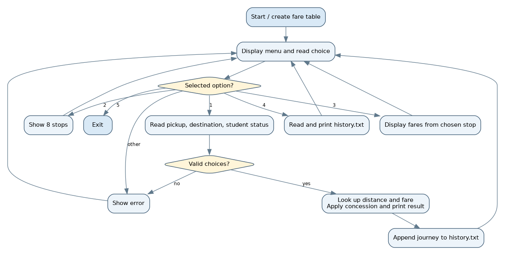
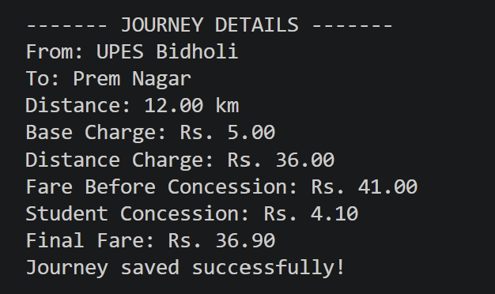
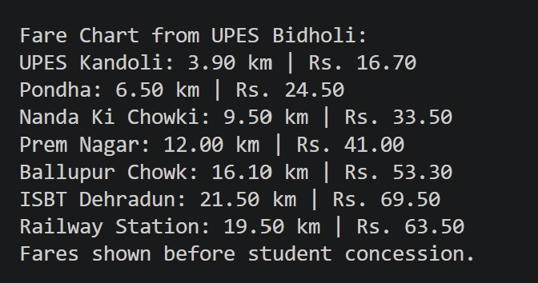
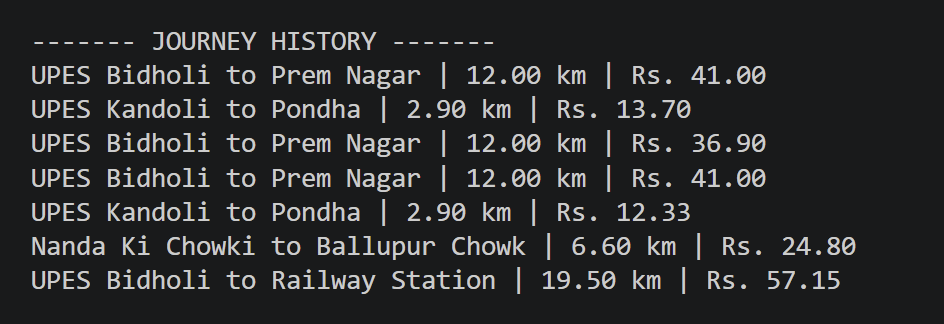
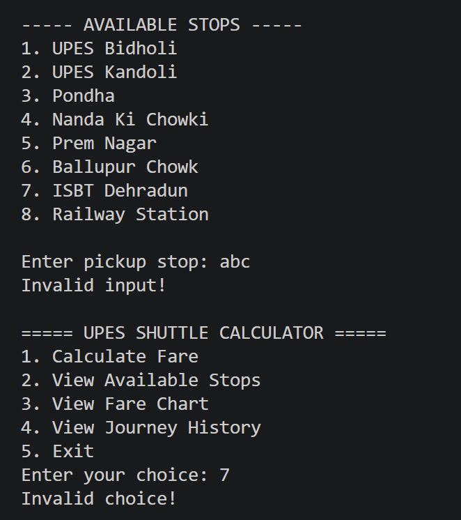

# UPES Shuttle Fare Calculator

**C Programming Mini Hackathon | UPES, Dehradun**  
**Team:** The Path | **Batch:** B-32

**Members:** Arihant (SAP 590035296), Kaustubh Beher (SAP 590036904).

## Problem statement
Build a menu-driven C application that displays predefined shuttle stops and fares, accepts boarding and destination stops, applies a student concession, rejects invalid stop selections, and displays the final fare.

## Features
- Eight predefined UPES/Dehradun stops.
- Approximate pairwise distance table and a fare table generated at program startup.
- Fare breakdown: base charge, distance charge, fare before concession, concession, final fare.
- 10% demonstration student concession (1 = yes, 0 = no).
- Fare chart from a chosen stop (before concession).
- Persistent journey history in `history.txt` using standard C file handling.
- Basic numeric and stop-range input checks, plus input-line clearing.

**Important:** This version uses **direct table lookup**, not Dijkstra's algorithm. Distances include user-reported Google Maps measurements and inferred/provisional values. Fares are illustrative, not official UPES tariffs or confirmed shuttle routes.

## Implementation and C concepts
`stops[8][40]` stores location names. `distance[8][8]` stores pairwise kilometres. Nested loops fill `fareTable[8][8]` using `5 + 3 * distance`. `calculateFare()` validates inputs, retrieves a fare, applies a 10% student concession when selected, and appends a record to a text file. `viewFareChart()` displays fares for all other stops. `viewHistory()` reads saved records line by line.

C concepts: arrays (including 2D arrays), strings, functions, loops, `if`/`else`, `switch`, arithmetic, `scanf`, `getchar`, file pointers, `fopen`, `fprintf`, `fgets`, and `fclose`.

## Algorithm / pseudocode
1. Initialize eight stop names and the complete pairwise distance matrix.
2. For each pair of stops, set its predefined fare to zero if the stops match; otherwise compute `base + distance * rate`.
3. Display a repeating menu: calculate fare, show stops, show fare chart, view history, exit.
4. For a journey, read pickup and destination, reject invalid or identical stops, and read student status (0/1).
5. Look up distance and fare from the two tables. If student, subtract 10% of fare. Print a detailed breakdown.
6. Append the journey to `history.txt` when the file opens successfully.
7. To view history, open `history.txt` for reading, display lines until end of file, and close it.

## Flowchart


## Compile and run (Windows with GCC)
```powershell
gcc -std=c11 -Wall -Wextra main.c -o shuttle.exe
.\shuttle.exe
```
Run these commands from the folder containing `main.c`. `history.txt` is generated in the working directory after successful fare calculations.

## Sample tests and results
All 13 tests were reported as passed during the team's local Windows testing. Four genuine terminal screenshots are included below as supporting evidence. See [`test_cases.csv`](test_cases.csv) for the full record.

| Test | Scenario | Expected result | Reported result |
|---|---|---|---|
| TC01 | Bidholi to Prem Nagar, student | Rs. 36.90 | Pass (team-reported) |
| TC02 | Bidholi to Prem Nagar, non-student | Rs. 41.00 | Pass (team-reported) |
| TC03 | Kandoli to Pondha, student | Rs. 12.33 | Pass (team-reported) |
| TC04 | Nanda Ki Chowki to Ballupur, non-student | Rs. 24.80 | Pass (team-reported) |
| TC05 | Bidholi to Railway, student | Rs. 57.15 | Pass (team-reported) |
| TC06 | Out-of-range destination | Invalid stop selection! | Pass (team-reported) |
| TC07 | Same pickup and destination | Invalid stop selection! | Pass (team-reported) |
| TC08 | Invalid student value | Invalid student selection! | Pass (team-reported) |
| TC09 | Alphabetic menu input | Invalid input! Try again. | Pass (team-reported) |
| TC10 | Alphabetic pickup input | Invalid input! | Pass (team-reported) |
| TC11 | Unknown menu option | Invalid choice! | Pass (team-reported) |
| TC12 | Fare chart from Bidholi | 7 destinations | Pass (team-reported) |
| TC13 | History persistence | Previously saved records visible | Pass (team-reported) |

## Output screenshots

The following images are genuine screenshots captured from the team's running program.

**Student concession: Bidholi to Prem Nagar (Rs. 36.90)**  


**Fare chart from UPES Bidholi**  


**Saved journey history**  


**Input validation (alphabetic pickup and invalid menu choice)**  


## Limitations and future scope
- Distances are predefined and partly provisional; the application does not access live maps or traffic.
- A shortest-path algorithm is **not** implemented in this version; all pairwise distances are prefilled.
- Fare and concession are demonstration assumptions, not official UPES prices.
- Input handling discards trailing characters after a valid integer (e.g., `2abc` is accepted as `2`); EOF is not specially handled at the main menu.
- Future work: verify routes and fares, strengthen input parsing, and optionally add route optimization or a graphical interface.

## Presentation
See [`presentation.pptx`](presentation.pptx) for the project slides. It describes the final fare-table version and student concession, not Dijkstra.
